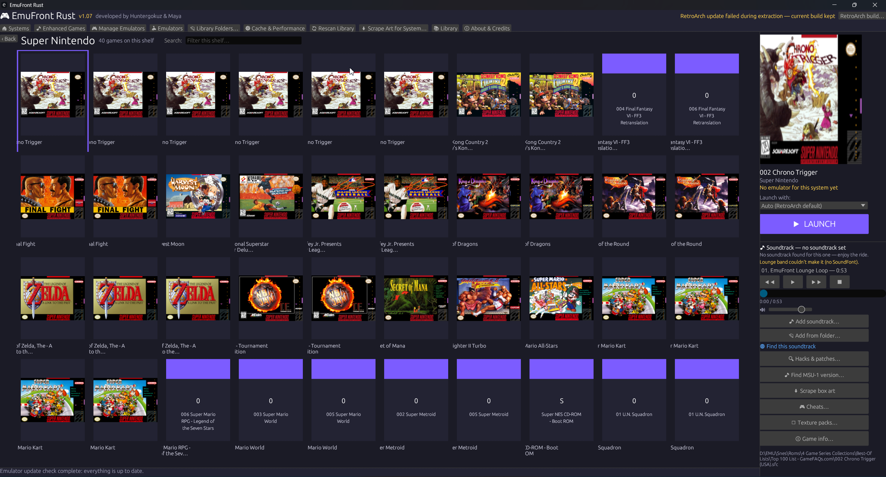
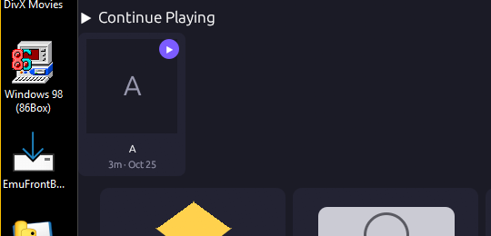
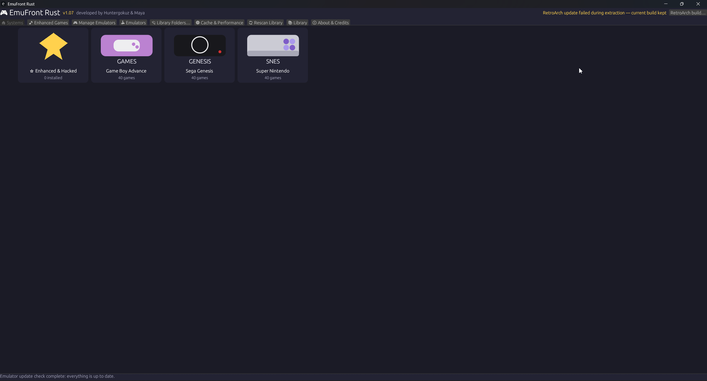

<p align="center">
  
</p>

<h1 align="center">EmuFront Rust</h1>

<p align="center">
  <b>A fast, native front end for your emulator library — Windows and Linux.</b><br>
  Browse your games as a wall of box art, pick one, and play.
</p>

<p align="center">
  
  
  
  
  
</p>

<p align="center">
  Developed by <b>Huntergokuz &amp; Maya</b>
</p>

EmuFront Rust is the Rust edition of EmuFront Box: a single native
executable (no runtime to install) built for very large libraries — it is
developed and tested against a real library of over **200,000 games**, and
designed to stay responsive on modest hardware, not just gaming PCs.

**Current public release: 0.07 Alpha.** The public version line starts at
0.07 Alpha and climbs (0.08, 0.09, …) toward a full 1.0 release.

> **EmuFront includes no ROMs and no BIOS files.** The application ships
> on its own — no game ROMs, no game data, no BIOS images, and no
> emulators. You supply your own legally obtained games and BIOS files;
> EmuFront just organizes, presents, and launches what you already have.



*Your library as a wall of box art. Select a game and its panel opens:
cover, the emulator that will run it, one big LAUNCH button, its
soundtrack, and every tool for that game in one place.*

## Contents

- [What it does](#what-it-does)
- [Download](#download)
- [System requirements](#system-requirements)
- [Full feature list](docs/FEATURES.md)
- [Roadmap](#roadmap)
- [Building from source](#building-from-source)
- [A note on data](#a-note-on-data)
- [Credits & thanks](#credits--thanks)
- [License](#license)

## What it does

- **Cover wall library browser** — your systems A–Z, games shown with box
  art (fetched in small batches from the libretro-thumbnails project and
  cached on disk, organized by system).

- **Letter-range browsing** — open a system and jump by letter bucket
  (0–9 / A–G / H–M / N–T / U–Z) instead of scrolling thousands of titles.

- **Sensible launch defaults** — RetroArch runs everything by default,
  except PlayStation 2 → PCSX2 and GameCube/Wii → Dolphin (standalone).
  Every other emulator you have is always offered under "Launch with:",
  and a pick you make by hand is remembered and locked for that game.

- **Live compatibility ratings** — the panel rates each game for the
  emulator that will actually run it, and updates the moment you change
  the pick. No data means an honest "no data", never another emulator's
  score.

- **ROM hacks, built in** — search RomHack Plaza and ROMhacking.net from a
  game's page, then download, patch, and stage in one flow with the
  built-in IPS/UPS/BPS patchers. **Your original ROM files are never
  modified** — patched copies are new files. New downloads landing in
  your Downloads folder are noticed automatically.

- **Enhanced games** — a dedicated catalog for Super Nintendo MSU-1 and
  Sega Genesis MD+/MSU-MD games (kept as two separate catalogs), with
  hunts across archive.org, Zeldix, GitHub, and the MiNERVA Archive, and
  the same pick-it-and-it-builds flow: your only job is choosing which
  one — download, unpack, patch, and stage all happen for you.

- **Per-game soundtrack player** — SPC (SNES), NSF (NES), VGM (Genesis/
  SMS), and MIDI soundtracks play from the game's page, with track lists
  under the LAUNCH button. A game with no soundtrack set plays a built-in
  lounge loop instead of silence: *"No soundtrack found for this one —
  enjoy the ride."*

- **Texture packs** — for systems that support them, download, install,
  and run with HD texture packs, per game, from the game's page.

- **Cheats, Game Info, BIOS Manager** — cheat browsing from
  libretro-database, per-game information, and a BIOS checker that tells
  you plainly which required files you have and which you're missing —
  no guessing before you launch.

- **Emulators tab** — one-click standalone launches of PCSX2, Dolphin,
  and DuckStation; if an executable can't be found, pick it once and
  EmuFront remembers.

- **Emulator update checks** — see at a glance which of your installed
  emulators (21 projects checked) have newer versions available, and
  jump straight to the release. RetroArch itself can be kept current
  automatically: pick the Nightly or Stable channel once, and EmuFront
  checks and updates it in place at startup.

- **PC Ports shelf** — native decompilation/recomp ports installed via
  [Quiver Launcher](https://quiverlauncher.com), launched directly —
  plus standalone collections such as AmigaVision.

- **Playtime & Continue Playing** *(new in 0.07 Alpha)* — playtime and
  last-played tracking for every game, a Continue Playing strip on Home,
  and a "New This Week" shelf for fresh additions to your library (your
  existing library is stamped as the baseline, so it can never pose
  as new).

  

  *Continue Playing — pick up right where you left off, with your
  playtime tracked for every game.*

- **Discord "Now Playing"** *(0.07 Alpha, optional)* — Rich Presence
  over a local pipe while a tracked game runs. Off until you paste in
  your own Discord application ID in Settings; no sign-in, no tokens,
  no network.

- **Built for other people's machines** — a derived-data snapshot so
  cold starts don't re-scan everything (a 200k-game library loads in
  about half a second), a capped on-disk cover cache, background art
  loading tuned to scroll direction, and a low-spec mode for older PCs.



*Home: every system on one wall, A–Z, with counts — plus the Enhanced &
Hacked shelf for everything you've built.*

The complete, detailed feature list lives in
**[docs/FEATURES.md](docs/FEATURES.md)**.

## Download

Prebuilt builds are published on this repository's
**[Releases](../../releases)** page, starting with **0.07 Alpha**.

**Linux:** the source tree now builds and runs on Linux (Stage 1 —
see *Building from source* below); a packaged Linux download is
planned. On Linux you will need `libxkbcommon-x11` and a `7z` binary
on your PATH.

EmuFront only *points at* your emulators — it never bundles, embeds, or
modifies them. Each emulator stays its own standalone install.

**Installing emulators is your choice, per emulator.** When you install
EmuFront, for each supported emulator (RetroArch, PCSX2, Dolphin,
DuckStation) you pick one of two options: use the copy you already have
installed (EmuFront finds it, or you point at it), or have the installer
download and install it for you from its official site, at your request.
Nothing is ever downloaded silently, and BIOS files are never fetched —
they remain your own.

## System requirements

- **Windows 10 64-bit or later** (hard floor — Windows 7/8 are not
  supported), or **Linux** (x86-64; tested on Ubuntu 24.04)
- ~2008-or-later dual-core CPU
- 4 GB RAM (low-spec mode), more is comfortable but not required
- A graphics driver with OpenGL 2.0+
- An HDD is fine

## Roadmap

- **Windows** — the current release platform (0.07 Alpha, above).
- **In development** — favorites and personal star ratings, custom
  shelves, a "Surprise me" random picker, a backlog roulette, and smart
  shelves (never played / not played in a year / no box art yet).
- **Linux** — in the tree now: the Stage 1 port is folded into this
  source (builds and runs; packaging and polish in progress).
- **macOS** — next. EmuFront is built on a cross-platform Rust
  UI foundation; the remaining work is file paths, emulator launching,
  and packaging.
- **Android** — planned as its own sibling project, not a quick port:
  Android needs a touch-first interface, a different way of launching
  emulator apps, and storage that works within Android's permission
  rules. Distribution would be an APK from this project's Releases page.

## Building from source

You need a Rust toolchain and a MinGW-w64 toolchain on `PATH` (the build
compiles one bundled C++ library, libgme, so a C++ compiler is required):

```sh
cargo build --release
```

The executable icon is embedded at build time from `icon/` if present.
Release builds use fat LTO and a single codegen unit (see `Cargo.toml`),
so the first release build takes a while.

Configuration: EmuFront keeps its settings beside the executable. Its
data folder (shared config, artwork cache, staged content) defaults to
an `EmuFront` folder beside the executable; set the `EMUFRONT_DIR`
environment variable to point it anywhere else.

## A note on data

Everything EmuFront learns about *your* library — the shared config, your
settings, playtime, art cache — lives in local files on your machine and
is never sent anywhere. None of it belongs in this repository (see
`.gitignore`).

## Credits & thanks

*Every borrowed piece of code and data is credited in the app itself,
under "developed by Huntergokuz & Maya".*

EmuFront Rust builds on a lot of open-source and community work:

- **egui / eframe** (MIT, Emil Ernerfeldt & contributors) — UI framework
- **serde / serde_json, image, ureq, sha1, flate2** — MIT OR Apache-2.0,
  Rust ecosystem
- **game-music-emu** crate (MIT), wrapping **libgme / Game_Music_Emu**
  (LGPL-2.1+) by Shay Green (blargg) & contributors — chiptune playback
- **rustysynth** (MIT) — SoundFont MIDI synthesis; **GeneralUser GS
  SoundFont** by S. Christian Collins
- **rodio** (MIT OR Apache-2.0) — audio output
- **discord-rich-presence** (MIT OR Apache-2.0) — Discord presence
- **libretro-thumbnails** — box artwork; **libretro-database** — cheat data
- **IPS** patch format (community); **UPS & BPS** formats by Near (byuu)
- **RomHack Plaza** and the ROM-hacking community — hack listings & files
- **Zeldix** — MSU-1 patch index; **GitHub patch authors** (infinest and
  others) — MD+/MSU-1 patch repos; **MiNERVA Archive** — MD+ pack mirror
- **Wikipedia contributors** (CC BY-SA 4.0) — game descriptions
- **RetroArch / libretro team** — the emulation backbone
- **ES-DE (EmulationStation Desktop Edition)** — design inspiration for
  front-end behavior and system definitions (MIT; no ES-DE code is used)
- The **EmuFront Lounge Loop** is an original composition for EmuFront.

Full notices live in `THIRD-PARTY-NOTICES.md`.

## License

MIT — see [`LICENSE`](LICENSE). Copyright (c) 2026 Huntergokuz & Maya.

One exception to know about: chiptune playback links **libgme**
(LGPL-2.1-or-later) — see `THIRD-PARTY-NOTICES.md` for details.
